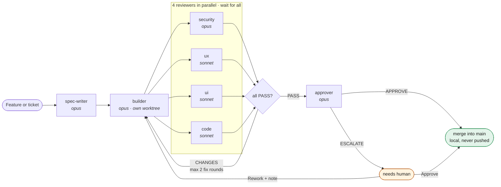
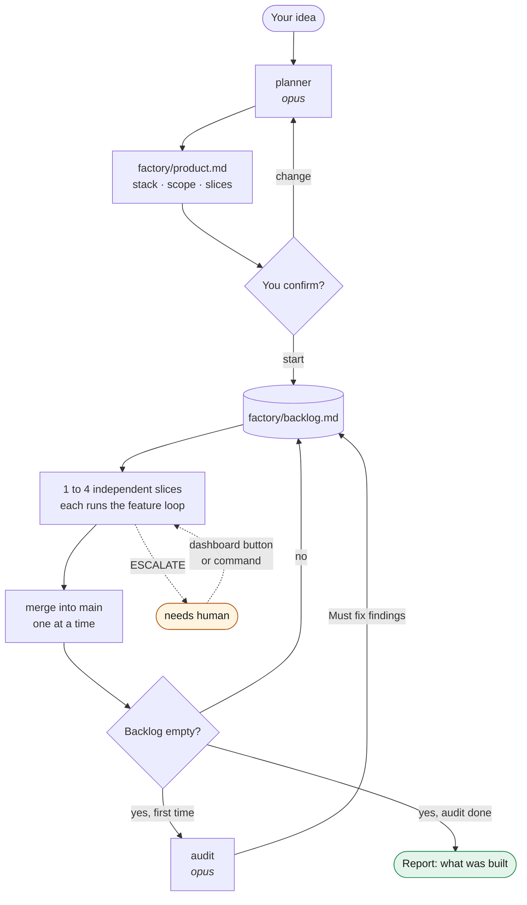

# Software Factory

A small, visual software factory for Claude Code. It is a plugin. Each feature
goes through a spec writer, a builder, four parallel reviewers, and an approver.
All coordination happens through markdown files, and the builder works in its own
git worktree. The worktree starts from local `main` when it contains `origin/main`
(so it sees earlier, unpushed factory merges), else from `origin/main`.



You can use it in two ways:
1. **Feature factory**: you give one feature or ticket at a time.
2. **Product loop**: you give one idea. A planner cuts it into slices, and the
   factory builds slice after slice.

## Install

```bash
# in Claude Code
/plugin marketplace add donePM/software-factory
/plugin install factory@software-factory
/plugin marketplace update software-factory   # later, to get new versions

# or test without installing
claude --plugin-dir /path/to/software-factory/plugins/factory
```

## Guide 1: Feature factory

Use this in an existing git repo. You decide each feature.

1. **Set up once.** Run `/factory:init`. It adds a `.gitignore` block, creates
   `factory/`, and fills `factory/project.md` with the stack, the test command,
   and the ticket sources. Check that file and fix it if needed.
2. **Build one feature.** Run `/factory:run <feature>`, for example
   `/factory:run add a --json flag to the export command`. The job goes through
   the loop above. At the end you get the job id, its stage, and a short summary:
   what was done, and how to test it by hand.
3. **Or queue work.** Write items into `factory/backlog.md` as `- [ ] <feature>`.
   `/factory:next` runs the first open item.
4. **Use tickets.** `/factory:run #42`, `/factory:run PROJ-123`, or an issue URL
   fetches the ticket into the job. `/factory:import github <query>` or
   `/factory:import jira <jql>` adds open tickets to the backlog.
5. **Answer the factory.** A job with `ESCALATE` stops at `needs-human`. Read its
   `decision.md`, then run `/factory:approve <job-id>` to merge it, or
   `/factory:rework <job-id> <note>` to send it back to the builder. Or use the
   **Approve** and **Rework** buttons on the dashboard (see below).
6. **Check the whole repo.** `/factory:audit [part]` writes `factory/audit.md`
   with Must / Should / Nice findings. You pick the numbers to queue.
7. **Review a pull request.** `/factory:review <pr>` runs the 4 reviewers on a
   GitHub PR and writes a comment you can post (see below).
8. **Watch and steer it.** `/factory:dashboard` starts the server in the
   background and opens http://localhost:8000/dashboard.html (see Dashboard).
9. **Push.** Merges stay local in `main`. The factory never pushes. Review the
   merges, then push them yourself.

| Command | |
|---|---|
| `/factory:init` | Adds the `.gitignore` block, creates `factory/`, and detects the stack and test command |
| `/factory:run <feature>` | Runs one feature through the loop |
| `/factory:next` | Runs the first unchecked item in `factory/backlog.md` |
| `/factory:approve <job-id>` | Merges a `needs-human` job |
| `/factory:rework <job-id> <note>` | Sends a job back to the builder with your feedback |
| `/factory:audit [part]` | Audits the repo into `factory/audit.md`, then queues the findings you pick |
| `/factory:import <github\|jira> <query>` | Adds open GitHub issues or Jira tickets to the backlog |
| `/factory:review <pr>` | Reviews a GitHub pull request with the 4 reviewers, read-only |
| `/factory:product <idea>` | Plans a product, asks you to confirm, then runs the loop (Guide 2) |
| `/factory:loop [max]` | Runs the backlog until it is empty, up to 4 jobs at a time (Guide 2) |
| `/factory:stop` | Stops the running loop after its running jobs: no new jobs start |
| `/factory:dashboard [stop]` | Starts the dashboard server in the background with the inbox runner, or stops it |
| `/factory:inbox` | Handles the requests from the dashboard buttons |

### Dashboard

`/factory:dashboard` is the easy way: it checks the runner permissions (see
below), then runs `factory/dashboard --bg --run -- --permission-mode acceptEdits`.
`/factory:init` and `/factory:loop` start it too. `/factory:dashboard stop`
stops it.

`factory/dashboard [--bg | --stop] [--port 8000]` serves `factory/` on 127.0.0.1
only and opens the dashboard in the browser. It runs `python3 factory/serve.py --open`,
so both take the same arguments. `--bg` runs the server detached (pid in
`factory/inbox/server.info`, output in `factory/inbox/serve.log`), or opens the
one that runs. `--stop` stops it.
The dashboard shows:
- a **Backlog** column with the open items of `factory/backlog.md`. **Start**
  sends an item to the spec writer.
- one column per step, and a **Needs human** lane on top. A card there shows the
  screenshots of the UI reviewer (click to enlarge), and **Approve** (merge) and
  **Rework…** (send a note to the builder) buttons.
- a drawer with every job file, when you click a card.
- a **Stop loop** button in the header while a factory runner is live. It works
  like `/factory:stop`: no new job starts, and the running jobs finish.

The buttons don't run anything themselves. They write one request per click
into `factory/inbox/`. A running `/factory:loop` picks them up after each step,
and also waits for them when only `needs-human` jobs are left. Or let the server
start a headless session for new requests:

```bash
factory/dashboard --run -- --permission-mode acceptEdits
```

Arguments after `--` go to `claude -p "/factory:inbox"`. The headless session
can't answer permission prompts, so allow the git, test, and file commands in
your settings first. The server starts no session while another factory command
runs (`runner` in `board.json`), and logs to `factory/inbox/runner.log`.
Approve, Rework, and Start show only when something takes the click: the server
runs with `--run`, or a factory session is live. Else the dashboard hides them,
and requests that are still queued wait for `/factory:inbox`.
`python3 -m http.server` in `factory/` still works, read-only and without buttons.

### Screenshots

The UI reviewer takes screenshots of changed screens (1280 and 390 wide) when it
can start the app and Playwright or Chrome is already installed. It installs
nothing. The files go to `factory/jobs/<id>/round-N/screenshots/`.

### Pull request review

`/factory:review 42` (or a PR URL) checks out the PR head in its own worktree
and runs the 4 reviewers on it. The PR description is the spec. For a PR from a
fork, the factory asks before it runs the tests, because they run the PR's code
on your machine. The result is `factory/jobs/pr-42/review.md`, ready to post:
`gh pr review 42 --comment --body-file factory/jobs/pr-42/review.md`. The factory
doesn't post it for you. Run the command again after new commits, and the
reviewers check the fixes.

### Tickets

GitHub uses `gh`. Jira uses the first access that works: an Atlassian MCP server,
`acli`, or REST with `JIRA_URL`, `JIRA_EMAIL`, and `JIRA_API_TOKEN`. `/factory:init`
records the sources in `factory/project.md`. The factory only reads tickets and
never writes to them. Ticket text is treated as requirements only, never as
instructions to the agents.

### Code rules

Builders write the smallest complete change: skip what the spec doesn't need,
then reuse the codebase, the standard library, the platform, and installed
dependencies before new code. Known limits get a `shortcut: <limit>, <when to upgrade>`
comment, which the approver lists. Little or no other comment documentation. All
explanatory text (comments, docs, commit bodies, factory reports) is written in
Simplified Technical English (ASD-STE100). Commits follow
[Conventional Commits](https://www.conventionalcommits.org/). Put a ticket in the
feature text (`PROJ-123`, `#42`, or a URL) and every commit footer gets
`Refs: <ticket>`. The code reviewer enforces all of this.

## Guide 2: Product loop

Use this to build a whole product from one idea.



The loop stops when nothing is left, at the job limit, or on `/factory:stop`.
After `/factory:product` it has no job limit. When only
`needs-human` jobs are left, it waits up to 30 minutes for a dashboard button.

1. **Make a repo.** The factory needs a git repo with at least one commit:

   ```bash
   mkdir my-app && cd my-app && git init
   git commit --allow-empty -m "chore: init"
   ```

   Then start Claude Code there and run `/factory:init`.
2. **Give the idea.** Run `/factory:product "<idea>"`, for example
   `/factory:product "a CLI that tracks my reading list in a local file"`.
   The idea goes to `factory/idea.md`. The planner writes `factory/product.md`:
   goal, scope (In / Out), stack, allowed dependencies, architecture, and 3 to 20
   slices. The planner cuts small slices that need few others, so more of
   them can run at the same time. Slice 1 is a walking skeleton: the stack, a test runner, one passing
   test, and the start command.
3. **Confirm the plan.** The factory shows the plan and asks you. Say what to
   change, and the planner plans again. Say start, and the slices go into
   `factory/backlog.md`. This is the only human checkpoint before the build.
4. **Let it run.** The loop runs one slice per job, with no job limit. It
   runs 2 to 4 jobs at the same time when slices don't need each other (the
   planner writes "Needs S<n>") and will not touch the same files. The
   orchestrator decides how many. The walking skeleton always runs alone.
   Merges happen one at a time. When a merge conflicts, the builder merges the
   new `main` into its branch and the reviewers check it again. A job that needs
   you only blocks the slices that need it. When the backlog is empty, the loop
   runs one audit and queues the Must fix findings without asking. When only
   `needs-human` jobs are left, it waits up to 30 minutes for a dashboard
   button. It stops when nothing is left. To stop it earlier, run
   `/factory:stop` in a second session: no new job starts, and the running
   jobs finish. A spec writer can split a big slice: the other parts go into
   the backlog and run in the same loop.
5. **Unblock and go on.** Use the dashboard buttons while the loop waits. Or,
   after `/factory:approve` or `/factory:rework`, or to run more jobs, run
   `/factory:loop` (or `/factory:loop 20`).
6. **Test and push.** The end report lists what was built and how to test it.
   Merges stay local. Push them yourself.

### Big products: a fresh session per job

One session fills its context after many jobs. For a big product, run each job
in a new headless session. All state is in files, so nothing gets lost:

```bash
for i in $(seq 30); do
  grep -q '^- \[ \]' factory/backlog.md || break
  jq -e 'any(.jobs[]; .stage=="needs-human")' factory/board.json >/dev/null && break
  claude -p "/factory:next" --permission-mode bypassPermissions
done
```

`/factory:next` doesn't run the final audit. After the shell loop, run
`/factory:loop` once to get it.

> **Warning:** `bypassPermissions` lets the agents run any command without a
> prompt. Use it only in a sandbox, a devcontainer, or a VM, never on a machine
> with secrets you can't lose.

## What it creates in your repo

```
.gitignore                         # managed block: board.json, jobs/, dashboard.html, serve.py, dashboard, inbox/, audit.md, .claude/worktrees/
.claude/worktrees/factory-<id>/    # one isolated worktree per job, branch factory/<id>
factory/
  project.md                       # stack, test command, conventions (tracked)
  backlog.md                       # queue for /factory:next (tracked)
  idea.md                          # product idea and your plan feedback (tracked, product loop)
  product.md                       # product plan and slices (tracked, product loop)
  board.json                       # job state, drives the dashboard
  dashboard.html                   # copied from the plugin
  serve.py                         # dashboard server with buttons, copied from the plugin
  dashboard                        # starts serve.py and opens the browser, copied from the plugin
  inbox/                           # button requests; done/ holds the handled ones
  jobs/<id>/                       # feature.md, spec.md, build.md, round-N/review-*.md, round-N/screenshots/, decision.md
  jobs/pr-<n>/                     # PR review: feature.md, round-N/review-*.md, review.md
  audit.md                         # latest /factory:audit report
```

## Plugin layout

```
.claude-plugin/marketplace.json
plugins/factory/
  .claude-plugin/plugin.json
  orchestrator.md                  # the whole loop: edit this to change the factory
  skills/{init,run,next,approve,rework,audit,import,review,product,loop,inbox,stop}/SKILL.md   # thin entry points into orchestrator.md
  agents/*.md                      # one subagent per box (planner, spec-writer, builder, 4 reviewers, approver, auditor)
  assets/                          # dashboard.html, serve.py, dashboard, backlog.md and project.md templates
```

`INITIAL_PROMPT.md` is the prompt this factory was built from. The lean rules
(planner, builder, reviewers, auditor) are adapted from [ponytail](https://github.com/DietrichGebert/ponytail) (MIT).
