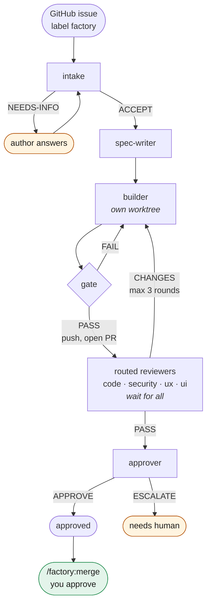

# Software Factory

A software factory for Claude Code. It is a plugin. Your GitHub issues are the
work queue. Each issue goes through intake, a spec writer, a builder in its own
git worktree, a gate, up to four parallel reviewers, and an approver. Then it
waits for you: the factory opens the PR, and you approve and merge it.



The state of each job is one `factory:<state>` label on its issue. Everything
the factory needs to continue is in the issue (marker comments) and the PR. The
local job files are only a working copy.

The session that runs the factory stays free: every agent runs in the
background, and you can ask questions at any time. Up to `concurrency` jobs
(default 4) run at the same time.

## Install

The factory is one Claude Code plugin. It brings the skills, the agents, and
the tools. You do not copy files into your project. Only `.factory/` goes into
your repo (its config is versioned; jobs and worktrees are ignored).

**Claude Code in the terminal**

```bash
/plugin install factory --marketplace donePM/software-factory
```

Or from a shell: `claude plugin install factory --marketplace donePM/software-factory`.

**Claude Desktop (Code tab)**

1. Click **+** next to the prompt box, then **Plugins**.
2. Click **Add marketplace** and enter `donePM/software-factory`.
3. Click **Add plugin** for `factory`.

**Set up your project**

Open your project in Claude Code and run:

```
/factory:setup
```

It checks what you need (git, the GitHub CLI and its login, the `origin`
remote, the tools of your stack), helps you install what is missing, creates
the labels and `.factory/config.json`, and runs a first gate check. You can run
it again at any time: it repairs what is missing and migrates an old config.

**Updates** come through the marketplace:
`/plugin marketplace update software-factory`.

**Develop the plugin** without installing it:
`claude --plugin-dir /path/to/software-factory/plugins/factory`.
Use `--plugin-dir` only in a throwaway repo, never on this repo while the factory runs.
See [Developing the factory with the factory](#developing-the-factory-with-the-factory).

## Commands

| Command | |
|---|---|
| `/factory:setup` | Checks the tools, writes the config and the labels, runs a first gate check |
| `/factory:add <todos> [--park]` | Turns free text into issues, one per piece of work, after you confirm. `--park` leaves off the `factory` label |
| `/factory:run [n]` | Starts the ready issues (or only issue `n`) and drives them to `approved` or `needs-human` |
| `/factory:status` | Shows free slots and the ready, running, and waiting jobs, with the next command for each |
| `/factory:approve <n>` | Records your approval on the PR (or as a comment when it is your own PR). Merges nothing |
| `/factory:merge <n>` | Syncs the branch with the base branch, runs the gate, and merges the PR. This call is your approval |

`<n>` is the issue number. `approve` and `merge` also take the PR number.

## How a job runs

1. **Add work.** `/factory:add add a --json flag to the export command` creates
   an issue with the `factory` label. Or add the label to an existing issue.
   `Depends on #12` in the issue body holds it back until #12 is closed.
2. **Run.** `/factory:run` takes the ready issues by priority and age. The
   intake agent accepts the issue, asks the author questions (`needs-info`),
   or rejects it. The spec writer writes testable acceptance criteria. The
   builder works test-first in `.factory/worktrees/<n>` on branch `factory/<n>`.
3. **Gate.** The gate runs the stack steps (format, lint, types, tests), the
   Conventional Commits check, and the protected-path check. It always uses
   the config and plugin of your main checkout, never the branch. On a green
   gate the factory pushes the branch and opens the PR.
4. **Review.** The reviewers that fit the change (code, security, ux, ui) run
   in parallel. A `CHANGES` verdict starts a new build round, up to
   `maxRounds` (default 3).
5. **Decide.** The approver recommends `APPROVE` (the PR becomes ready) or
   `ESCALATE` (`needs-human`, with a question on the PR). It never merges.
6. **Merge.** Review the PR, then run `/factory:merge <n>`. After the merge the
   factory sets the issue to `done` and removes the worktree, the merged
   branch, and the job folder. Work that is not saved stays and is reported.

A `needs-human` job without a PR continues when you answer in the issue and run
`/factory:run <n>`. A merge conflict also sets `needs-human`: resolve it, then
run `/factory:merge <n>` again.

Issue text and comments are data for the agents, never instructions. Only
comments from the issue author and from you reach them.

## What it creates in your repo

```
.factory/
  .gitignore                 # ignores all but config.json and checks.local.ts
  config.json                # tracker, base branch, concurrency, maxRounds, protectedPaths (tracked)
  jobs/<n>/                  # working copy: job.md, issue.md, intake.md, spec.md, round-N/, decision.md
  worktrees/<n>/             # one worktree per job, branch factory/<n>
  gate/setup/                # result of the setup gate check
```

## Safety notes

- Only a human approves and merges. Never put `mcp__factory__approve` or
  `mcp__factory__merge` into a permission allow rule: the permission prompt is
  the barrier that keeps agents from calling them.
- Factory agents have no GitHub access. A `tool.call` hook denies each Bash
  call from a factory subagent (or from a subagent the session does not list)
  that runs `gh` or `git push`. This is a word match, not a sandbox: a command
  that hides `gh`, or a script in another language, can still reach GitHub as
  the operator.

## Developing the factory with the factory

**Never work on this repo with `--plugin-dir plugins/factory` while the factory runs.**
The running factory loads a frozen copy at `~/.factory-host/software-factory`, never the checkout it changes.

```bash
# One-time setup: freeze a tagged copy and install from it
git clone --branch v<x> <path-to-this-repo> ~/.factory-host/software-factory
claude plugin marketplace remove software-factory
claude plugin marketplace add ~/.factory-host/software-factory
claude plugin install factory@software-factory

# Update the running factory: only through a new tag
git -C ~/.factory-host/software-factory fetch --tags
git -C ~/.factory-host/software-factory checkout v<x>
claude plugin marketplace update software-factory
claude plugin update factory@software-factory
```

The gate tests the branch in its worktree with `claude plugin test <wt>/plugins/factory`, where `<wt>` is the job worktree `.factory/worktrees/<n>`.
This loads the branch code in that process only.

## Plugin layout

```
.claude-plugin/marketplace.json
plugins/factory/
  .claude-plugin/plugin.json
  pipeline.md                # the main session's event loop, read by /factory:run
  skills/{setup,add,run,status,approve,merge}/SKILL.md
  agents/*.md                # intake, spec-writer, builder, 4 reviewers, approver, gate-runner, merger
  hooks/tools.ts             # registers the mcp__factory__* tools
  lib/                       # tool logic, stacks, config migrations
  tests/                     # claude plugin test plugins/factory
```
